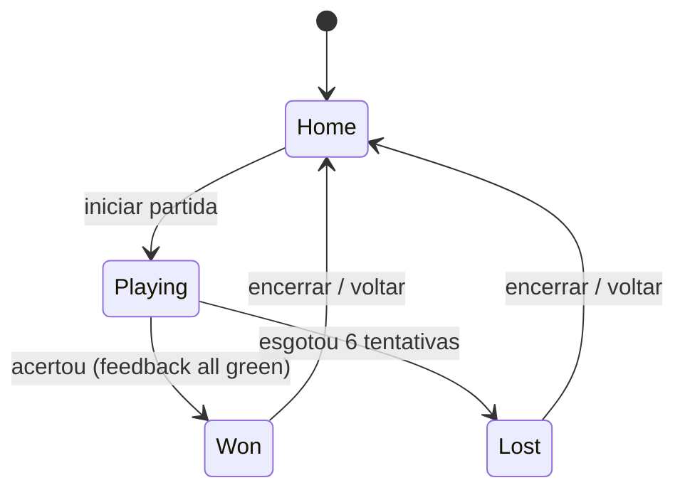

# SPECS — Projeto Técnico

## Jogo Casual de Adivinhação de Palavras — `cacaPalavras`

> Documento derivado do PRD (`PRD.md`) e dos protótipos aprovados (`prototypes/`).
> Fonte de verdade do produto: PRD. Fonte de verdade do *como construir*: este documento.

---

## 1. Visão técnica do produto

Implementação web responsiva mobile-first do jogo casual diário de adivinhação de palavras, em HTML5 + CSS3 + JavaScript vanilla (ES6), sem frameworks, sem build step e sem backend. Toda a aplicação é estática, servida por um servidor HTTP estático e executável em navegadores modernos.

---

## 2. Design escolhido

### 2.1 Decisão

**Design final do MVP:** síntese do **Protótipo 2 — "Acessível e Clara"** com refinamentos visuais do **Protótipo 3 — "Temático Moderno"**.

- **Base estrutural e funcional:** Protótipo 2. Suas decisões de acessibilidade são requisitos inegociáveis do PRD e foram tratadas como restrições de design centrais:
  - alto contraste (texto `#111` sobre fundo claro, ≈17:1);
  - fonte base 18px / títulos 24–32px;
  - botões com alvo mínimo de 48×48px;
  - feedback composto por cor + marcador textual (✓ / ⇄ / ✕) + rótulo — nunca cor apenas;
  - `aria-live`, skip link, foco visível, landmarks, `prefers-reduced-motion`;
  - tutorial com até 2 frases curtas.
- **Identidade visual:** Protótipo 3. Paleta temática por categoria (animais/natureza = verde; comida = laranja; ciência = roxo; esportes = azul), fundos em gradiente, tiles coloridos com estados (verde/âmbar/cinza), estados de vitória (trophy/confete) e derrota (consolação), tipografia redondada e playful, alvos grandes.

### 2.2 Telas (derivadas dos protótipos)

1. **Tela inicial** — nome, tagline, como funciona (≤2 frases), tema do dia, CTA, resumo de estatísticas.
2. **Tela de partida** — chip de tema, "5 letras", slots de tiles, input de palpite, feedback, tentativas restantes, voltar ao início.
3. **Tela de resultado** — vitória/derrota, tentativas usadas, palavra revelada, ações.

---

## 3. Escopo técnico do MVP

- Jogo diário (1 palavra/tema por dia, mesma para todos na data).
- 5 letras, até 6 tentativas.
- Feedback por letra (verde/amarelo/cinza) com marcadores.
- Validação de palpite, limite de tentativas, bloqueio de repetição.
- Streak contínua (pular dia reinicia), estatísticas básicas.
- Compartilhamento por cópia de texto (sem revelar solução).
- Web responsiva mobile-first, acessível, sem cadastro, sem monetização.

---

## 4. Stack e ambiente

| Camada | Tecnologia |
|---|---|
| Estrutura | HTML5 semântico |
| Estilo | CSS3 custom (variáveis, flexbox/grid), sem frameworks |
| Lógica | JavaScript ES6 vanilla (modules/não-modules conforme servido) |
| Build | Nenhum (arquivos estáticos servidos diretamente) |
| Backend | Nenhum (MVP) |
| Persistência | `localStorage` |
| Hospedagem alvo | Estática (ex.: Firebase Hosting / Netlify / S3) |
| Navegadores | Chrome, Firefox, Safari, Edge (versões recentes) |

---

## 5. Estrutura de arquivos

```
/
├── index.html
├── css/
│   └── style.css
├── js/
│   ├── data.js     # listas de palavras por tema + seleção da palavra do dia
│   ├── game.js     # estado, lógica de feedback, validação, tentativas
│   ├── storage.js  # streak e estatísticas (localStorage)
│   └── app.js      # orquestração da UI e eventos
└── prototypes/
    ├── prototype-1-adventura.html
    ├── prototype-2-acessivel.html
    └── prototype-3-tematico.html
```

---

## 6. Modelo de dados

### 6.1 Entidades

- **Resposta (Answer):** `{ category: string, word: string }`
- **Palpite (Guess):** `string` (5 letras)
- **Feedback:** `Array<{ letter, state }>` onde `state ∈ {"green" | "yellow" | "gray"}`
- **Estado de jogo (GameState):**
  - `status: "playing" | "won" | "lost"`
  - `category: string`
  - `word: string`
  - `guesses: string[]`
  - `feedbackByGuess: Array<Array>` (feedback de cada palpite)
  - `attemptsUsed: number`
- **Estatísticas (Stats):** `streak`, `bestStreak`, `wins`, `gamesPlayed`, `lastPlayedDate`, `lastWordCategory?`

### 6.2 Persistência (`localStorage`)

Chave: `cacaPalavras.stats.v1`

```json
{
  "streak": 0,
  "bestStreak": 0,
  "wins": 0,
  "gamesPlayed": 0,
  "lastPlayedDate": "YYYY-MM-DD",
  "lastResult": "won | lost"
}
```

---

## 7. Máquina de estados



Transições de UI:
- `Home → Playing`: a partir da CTA "Jogar hoje".
- `Playing → Won`: palpite == resposta (feedback all green).
- `Playing → Lost`: `attemptsUsed >= 6` após avaliação.
- `Won/Lost → Home`: resultado + estatísticas.

---

## 8. Geração da palavra do dia

- **Seed:** `YYYY-MM-DD` (data local).
- **Categoria:** rotação simples das 4 priorizadas (animais, comida, ciência, esportes) baseada no dia do ano.
- **Palavra:** seleção determinística dentro da lista da categoria do dia (hash da seed).
- Regras: mesma palavra para todos na data; tamanho fixo 5; categoria pertence ao tema.

---

## 9. Lógica de feedback por letra

Algoritmo (incluindo tratamento de letras duplicadas):

```
computeFeedback(guess, answer):
  result[0..4] = "gray"
  remaining = {}
  for i in 0..4:
    if guess[i] == answer[i]:
      result[i] = "green"
    else:
      remaining[answer[i]] += 1
  for i in 0..4:
    if result[i] == "green": continue
    if remaining[guess[i]] > 0:
      result[i] = "yellow"
      remaining[guess[i]] -= 1
  return result
```

---

## 10. Tentativas e validação

- Máximo de 6 tentativas por partida.
- Palpite inválido (não pertence ao vocabulário permitido da categoria / formato incorreto) → aviso claro, **não consome tentativa**.
- Palpite repetido → bloqueado, aviso claro, **não consome tentativa**.

---

## 11. Telas e componentes (implementação)

Implementação fiel aos protótipos escolhidos, com responsividade mobile-first:

1. **Tela inicial:** título, tagline, como funciona (2 frases), chip de tema do dia, CTA principal, bloco de estatísticas.
2. **Tela de partida:** chip temático, contador "5 letras", slots de tiles, input de palpite, feedback, tentativas restantes, voltar ao início.
3. **Tela de resultado:** card de vitória/derrota, tentativas usadas, palavra revelada, botões de ação.

Componentes CSS: variáveis, tiles com estados, botões grandes, chips, cards.

---

## 12. Acessibilidade (implementação técnica)

- Contraste ≥ 4.5:1 (principalmente ≈17:1 no texto).
- Tipografia: base 18px, escalas 24–32px.
- Botões ≥ 48×48px com foco visível.
- Feedback: cor + marcador + texto.
- `aria-live="polite"` para feedback; labels; landmarks; skip link; foco visível.
- `prefers-reduced-motion`.
- Linguagem simples em PT-BR.

---

## 13. Compartilhamento

- Cópia de texto: `"Acabei de jogar hoje e usei ${n} tentativas!"` (sem revelar solução).
- Uso de `navigator.clipboard` com fallback.

---

## 14. Requisitos não funcionais

- Carregamento < 2s (estático, sem assets pesados).
- Layout responsivo (mobile-first, max-width 430px desktop).
- Performance consistente.

---

## 15. Fora do escopo (MVP)

- Ranking, multiplayer, monetização, avatar avançado, tutorial longo, etc.

---

## 16. Próximas fases

- Mais categorias/palavras, dificuldade, histórico detalhado, desafios semanais, elementos sociais.
